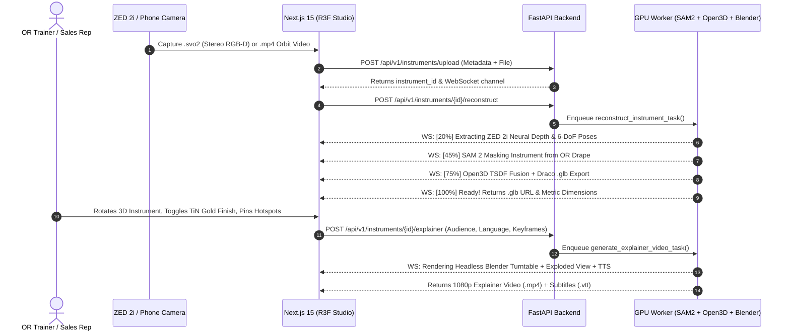

# Detailed Architecture: Surgical Instrument 3D Reconstruction & Explainer Pipeline

## Why Surgical Instruments Need a Specialized Pipeline
Orthopedic knee surgery instruments—such as a **Tibial Cutting Jig**, **Femoral Sizer**, **Intramedullary Alignment Rod**, or **Bone Rongeur Forceps**—pose two major computer vision challenges:
1. **High Specularity & Thin Geometry:** Surgical-grade 316L stainless steel and titanium reflect overhead operating room lights, causing standard photogrammetry (COLMAP) to fail or produce noisy holes.
2. **Cluttered Clinical Background:** During an operation or back-table setup, instruments sit on green surgical drapes or inside perforated sterilization trays alongside gloved hands.

### How Our Architecture Solves This
1. **ZED 2i Stereo Camera with Polarizer (`NEURAL_PLUS` Depth Mode):**
   Instead of guessing depth solely from RGB features, the ZED 2i uses a 120mm stereo baseline and a neural depth network trained to handle reflective surfaces, outputting metric-scale depth maps (`.png` 16-bit) and 6-DoF camera poses (`transforms.json`) directly from `.svo2` recordings.
2. **SAM 2 (Segment Anything Model 2) Video Masking:**
   Tracks only the target surgical instrument across all frames, zeroing out background pixels (drapes, hands, tray) in both the RGB and Depth maps prior to 3D fusion.
3. **Hybrid 3D Reconstruction (Open3D TSDF + 3D Gaussian Splatting):**
   - **Open3D TSDF (Truncated Signed Distance Function):** Integrates masked depth frames into a watertight, metric-accurate `.glb` polygon mesh in seconds.
   - **PBR Material Separation:** Applies configurable metallic/roughness shaders so users in Next.js can swap finishes (*Satin Stainless Steel*, *Titanium Nitride Gold*, *Matte PEEK Polymer*, *Anodized Aluminum*) in **0ms** without rescanning.
4. **Automated Explainer Video Generation (Stretch Goal):**
   - **Headless Blender (`bpy`)** loads the `.glb` instrument model, animates a 360-degree turntable and exploded sub-component separation along the Z-axis, renders 3D callout labels, and muxes AI voiceover audio generated for the chosen audience (*Scrub Nurse Training*, *Surgeon Sales Demo*, or *Patient Overview*) and language.

## Mermaid.js System Sequence Diagram

